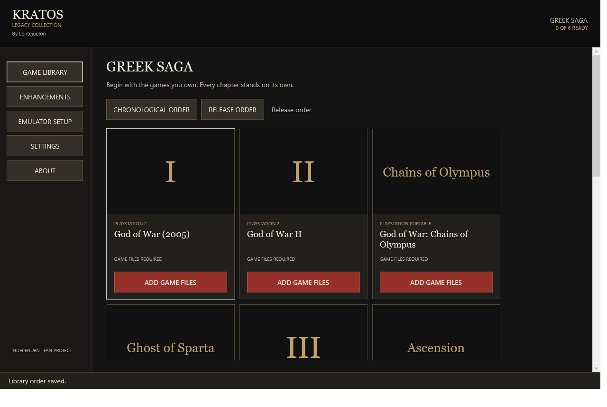

# Kratos Legacy Collection

A free Windows desktop launcher for your own Greek saga collection. Built with C#, .NET 10 LTS and WPF. Each game can be configured and launched independently.



## Library

- God of War (2005), PCSX2
- God of War II, PCSX2
- God of War: Chains of Olympus, PPSSPP
- God of War: Ghost of Sparta, PPSSPP
- God of War III, RPCS3
- God of War: Ascension, RPCS3

## Run

Extract the complete portable build into a writable folder and run `KratosLegacyCollection.exe`. Keep all files in the published folder together. The self-contained Windows x64 build includes the .NET runtime; emulators and game files are supplied separately. Windows 10 22H2 or Windows 11 x64 is the intended platform. Older Windows versions and another PC's graphics hardware require separate validation.

First-Time Setup saves progress after each step. Configure only the emulators you need, add your own files, import compatible enhancements and play. Setup can finish with no games or emulators. Reopen it from Settings whenever needed.

Launcher data is stored in `Data` beside the executable when writable. A read-only application location falls back to `%LOCALAPPDATA%/KratosLegacyCollection`. For a separate private collection folder, start with `KratosLegacyCollection.exe --data-root "D:/MyCollection"`. Paths inside the collection are stored relatively, so moving the whole folder preserves them. Existing files elsewhere on the same removable volume use `@volume/` paths anchored to its current drive root, allowing a drive-letter change without moving those files. Other external game and emulator paths remain external until explicitly copied.

## What works

- Resumable setup, manual executable checks, version discovery and official download links.
- Read-only searches, ISO9660 and PARAM.SFO identity inspection, region display and independent readiness states.
- Documented emulator launch arguments using `ProcessStartInfo.ArgumentList`, without a shell.
- Copy-only transfers with free-space checks and SHA-256 verification. New destinations are required; originals are preserved.
- Portable PCSX2/PPSSPP copy preparation. Review BIOS, memory-stick paths, folders and controls in the copied emulator before marking it configured.
- ZIP texture import for identified PCSX2 and PPSSPP layouts, with private payload storage, ownership records, backups, enable/disable and uninstall.
- User-supplied PS2 PNACH and PSP cheat import with exact identity markers. RPCS3 uses its native hash-aware patch manager.
- Individual graphics preferences, PCSX2 2.6+ game overlays, PPSSPP append-config profiles and private RPCS3 configuration copies.
- Launcher settings backup/restore, English UI, keyboard focus, logs and original vector architectural illustrations.
- Artwork extraction from user-provided PSP ISO / PS3 disc files, manual PNG/JPEG selection and verified per-game SteamGridDB links. No artwork API is used.

## Deliberate limits

- No games, BIOS, firmware, emulator binaries, patch code or texture packs are bundled or downloaded automatically.
- ZIP is the supported archive format. No unreviewed 7Z extraction process or archive scripts are executed.
- Compressed PSP CSO and PS2 CHD identities must be confirmed from the emulator. An ISO file hash is never treated as a PS2 ELF CRC.
- The catalog is a conservative allowlist of regional Game IDs. An unlisted release is rejected until its metadata is reviewed and added.
- Existing custom emulator texture directories must match the selected data folder. Check the actual folder in the emulator before installing enhancements.
- RPCS3 profiles change resolution scale and a supported renderer in a separate copy of its existing configuration. Firmware, controller calibration and PPU patch selection use RPCS3's own interface. Unsupported configuration layouts are rejected.
- A patch's ID marker cannot prove its gameplay behavior. Verify its source, revision and emulator requirements. Frame-rate patches can alter physics, animations, audio and cutscenes.
- The creator's Discord invitation was verified against an original publication on 2026-10-27. Links can change. A user-provided replacement requires confirmation of its source. No account access or download is automated.
- Real game boot, full playthroughs, USB disconnection during writes, controller bindings and performance on another PC require manual checks. See [testing](docs/TESTING.md).

## Build and test

Install the .NET 10 SDK on Windows. No third-party NuGet packages are needed for the core, WPF application or executable regression suite.

```powershell
dotnet build KratosLegacyCollection.sln -c Release -m:1 -nr:false
dotnet run --project tests/KratosLegacyCollection.Tests -c Release
dotnet run --project tests/KratosLegacyCollection.UiChecks -c Release --no-build
dotnet publish src/KratosLegacyCollection.App -c Release -r win-x64 --self-contained true -p:DebugType=None -p:DebugSymbols=false -o artifacts/portable-win-x64
```

Publishing may need NuGet access for Microsoft's runtime packs. Close the running development build before rebuilding its output folder. The test suite creates legal generated fixtures under `artifacts/test-runs`, returns a nonzero exit code on failure and never requires commercial games. Use `./scripts/Build.ps1 -Publish` to run the full sequence and copy the project's license, README, credits and the matching Microsoft runtime license notices into the distributable folder. Keep those notices with any shared build.

## Documentation

- [Architecture and implementation](docs/IMPLEMENTATION.md)
- [Emulator setup and portable copies](docs/EMULATORS.md)
- [Enhancement formats and research](docs/ENHANCEMENTS.md)
- [User-provided artwork](docs/ARTWORK.md)
- [Test coverage and manual acceptance](docs/TESTING.md)
- [Local candidate report](docs/DEVELOPMENT-REPORT.md)
- [UI verification](docs/UI-VERIFICATION.md)
- [Publication review](docs/PUBLICATION.md)
- [Credits](CREDITS.md)

## License and affiliation

Launcher code and original vector artwork are MIT licensed. System fonts are used without redistribution. Emulators, games and third-party enhancements retain their own licenses and rights.

This is an independent, unofficial fan project. It is not affiliated with, endorsed by or sponsored by Sony Interactive Entertainment or Santa Monica Studio. Game and emulator names identify compatible content and belong to their respective owners. The project name has not received trademark clearance; review naming and distribution rights before a public release.
